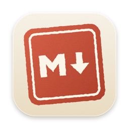
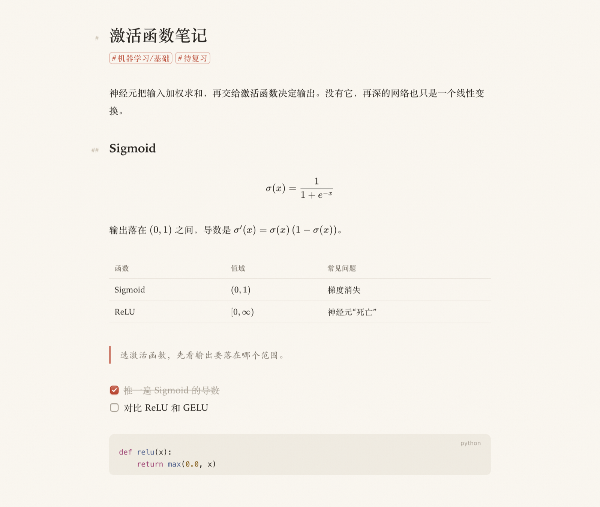
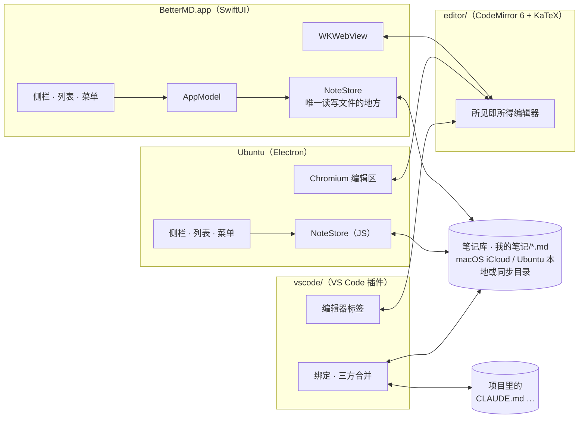

<div align="center">



# BetterMD

**写给自己，也写给 AI agent 的 Markdown 笔记。**

一个 Bear 风格的 macOS / Ubuntu 笔记 App：所见即所得的 Markdown，排得漂亮的公式，<br>
笔记就是普通的 `.md` 文件，还能在 VS Code 里用同一个编辑器打开。


[特色](#特色) · [截图](#截图) · [构建](#从源码构建) · [VS Code 插件](#vs-code-插件) · [快捷键](#键盘快捷键) · [开发](#开发)

</div>

---

## 特色

<table>
<tr>
<td width="50%" valign="top">

### ✍️ 所见即所得的 Markdown
Markdown 符号只在光标碰到的那一处露出来，别处直接显示排版效果。标题、列表、待办、表格、引用、代码高亮、图片都在正文里原地呈现，小标题可以折叠。

</td>
<td width="50%" valign="top">

### ∑ 公式像在纸上一样
LaTeX 公式用 KaTeX 排版，边写边看结果。认 `$…$`、`$$…$$`，也认从别处粘来的 `\(…\)`、`\[…\]`、`\begin{equation}` 和 ```` ```math ````；“花了 $5 和 $6”这种不会被误认成公式。

</td>
</tr>
<tr>
<td valign="top">

### 📁 笔记就是文件
每篇笔记一个 `.md`，文件夹就是磁盘上真实的文件夹，图片放在「附件」里。放在 iCloud 云盘，交给 iCloud 同步。任何编辑器都能打开，不锁在数据库里。

</td>
<td valign="top">

### 🏷️ 文件夹和标签分开管
文件夹管“放在哪”，可以多层；`#标签` 写在正文里，管“跟什么有关”，支持 `#会议/周会` 这样的多级标签。侧栏像笔记本：火漆信封是文件夹，散页是未分类。

</td>
</tr>
<tr>
<td valign="top">

### 🔎 中英文都搜得准
子串匹配，不做分词：只要这几个字在笔记里，就一定搜得到。不分大小写、全角半角，多个词同时命中，标题命中的排在前面，命中的字在列表摘要里高亮。

</td>
<td valign="top">

### 🤖 和 AI agent 一起用
在 VS Code 里用同一个编辑器打开任何 `.md`；把项目里的 `CLAUDE.md`、`AGENTS.md` 和一篇笔记**绑定**，两边谁改了都同步，两边都改了按三方合并合成一份。

</td>
</tr>
<tr>
<td valign="top">

### ⌨️ 手不离键盘
快捷键照 Bear 来：⌘1–⌘6 标题、⌘T 待办、⌘L 列表、⌘F 笔记内查找替换……← → 在侧栏、列表、正文之间走，在列表里直接打字就是搜索。

</td>
<td valign="top">

### 🛡️ 不丢字
自动保存、原子写入；保存前对比磁盘上的版本，别处也改过就把那一版另存一份；存不下去时不换库、退出时另存；中文输入法拼字时不打断、不丢字。

</td>
</tr>
</table>

## 截图

<div align="center">

<picture>
  <source media="(prefers-color-scheme: dark)" srcset="docs/images/editor-dark.png">
  
</picture>

<sub>纸墨风格：宋体配 Iowan Old Style，暖白纸色、墨色文字、朱砂点缀。深色模式是暖炭灰底。（截图会跟着你的 GitHub 主题切换深浅色）</sub>

</div>

## 从源码构建

### Ubuntu

需要 **Node.js 22.12 以上**、npm 和 Ubuntu 桌面环境。已在 **Ubuntu 26.04 x86_64** 验证；其他 Ubuntu 版本尚未实测。

```bash
scripts/ubuntu.sh package  # 安装依赖，构建编辑器，生成 .deb 和 tar.gz
sudo apt install ./build/ubuntu/BetterMD-0.2.0-linux-amd64.deb
bettermd
```

Ubuntu 版是同一套纸墨三栏界面：火漆信封的文件夹、多级标签、搜索、置顶、自动保存、图片粘贴/拖入、移动、废纸篓及恢复、外部文件监听、专注模式和深浅主题。默认笔记库是 `~/我的笔记`，可以打开已有的笔记库。正文、附件、`.bettermd/state.json` 和 VS Code 绑定登记与 macOS 版兼容。

**同步**：Linux 上没有 iCloud。在侧栏底下的同步按钮里填一个 git 仓库地址（比如 GitHub 上的私有仓库），改完笔记就自动提交、推送，别的电脑上的改动自动合进来——两边改了同一篇的不同地方会合成一份，改了同一段则以后改的为准、另一版另存，两份都留着。也可以直接把笔记库放进 Dropbox 这类同步盘的文件夹。

同步怎么设置、开发启动、沙箱配置和验证方式见 [Ubuntu 使用与开发](docs/ubuntu.md)。

### macOS

需要：**macOS 26**、**Xcode 26 / Swift 6.2 以上**、**Node.js 20 以上**（打包编辑器网页用）。

```bash
git clone <仓库地址> bettermd
cd bettermd
npm --prefix editor install

scripts/bundle.sh          # 先打包编辑器网页，再编译 App（release）
open build/BetterMD.app
```

第一次打开时，「我的笔记」会建在 **iCloud 云盘/我的笔记**（没开 iCloud 云盘时是 `~/我的笔记`），菜单「文件 → 选择笔记库位置…」可以换到别处。

> [!TIP]
> 想先试试、不碰真正的笔记：
> ```bash
> open -n build/BetterMD.app --args -libraryPath "$PWD/.build/dev-library"
> ```

## VS Code 插件

插件和 App 用的是**同一个编辑器网页**，在 VS Code 里打开 `.md` 就是 BetterMD 的样子。

```bash
scripts/vscode.sh --install   # 打包成 build/bettermd.vsix 并装进 VS Code，装完重新加载窗口
```

- **编辑器标签**：打开 `.md` 就是所见即所得的编辑器；标题栏一个按钮切回源码。深浅色跟着 VS Code 的主题，⌘B、⌘Z 这些键不会同时触发 VS Code 自己的功能。
- **「我的笔记」面板**：左边栏的笔记本图标。按文件夹、标签浏览，新建、搜索笔记，复制文件路径（直接告诉 agent 去读哪个文件）。
- **绑定**：在项目里的 `.md` 上右键「绑定到「我的笔记」…」，或者在面板里对一篇笔记「另存到项目并绑定…」。之后两边谁保存都会同步：

  | 情况 | 结果 |
  | --- | --- |
  | 只有一边改了 | 同步到另一边 |
  | 两边改了不同的段落 | 两边的改动都留，合成一份写回两边 |
  | 两边在同一处都新加了内容 | 两段都留，笔记的在前 |
  | 两边把同一段改得不一样 | 这一段以后改的为准；输的一边整篇另存一份，能直接查看差异 |

## 笔记怎么存

```
我的笔记/                 ← macOS 默认在 iCloud 云盘；Ubuntu 默认在用户主目录
├── 随手记.md             ← 放在根目录 = 未分类
├── 工作/
│   └── BetterMD/
│       └── 界面设计.md
├── 附件/                 ← 粘贴、拖进来的图片和文件
├── 废纸篓/               ← 删掉的笔记，可以放回原处
└── .bettermd/            ← 置顶、废纸篓来源、绑定这些小状态
```

- 标题取正文第一行，文件名跟着标题走。
- 图片用相对路径引用（如 `../附件/20261007-153012.png`），移动笔记时链接自动改写。
- 删除、移动不弹确认框，进废纸篓的笔记能放回原处。

## 键盘快捷键

Ubuntu 使用 **Ctrl** 代替下表中的 **⌘**，**Alt** 代替 **⌥**；代码块使用 **Ctrl+Shift+C**，保留 Ctrl+C 用于复制。Ubuntu 的完整常用键表在「帮助 → 键盘快捷键」。

<details>
<summary>展开看常用的（完整的在 App 里按 <kbd>⌘</kbd> <kbd>/</kbd>）</summary>

| 操作 | 快捷键 |
| --- | --- |
| 新建笔记 | <kbd>⌘</kbd> <kbd>N</kbd> |
| 在这篇里查找 / 替换 | <kbd>⌘</kbd> <kbd>F</kbd> / <kbd>⌥</kbd> <kbd>⌘</kbd> <kbd>F</kbd> |
| 搜索笔记 / 搜索全部 | <kbd>⇧</kbd> <kbd>⌘</kbd> <kbd>F</kbd> / <kbd>⌥</kbd> <kbd>⇧</kbd> <kbd>⌘</kbd> <kbd>F</kbd> |
| 一到六级标题 / 变回正文 | <kbd>⌘</kbd> <kbd>1</kbd>…<kbd>6</kbd> / <kbd>⌘</kbd> <kbd>0</kbd> |
| 粗体 / 斜体 / 删除线 | <kbd>⌘</kbd> <kbd>B</kbd> / <kbd>⌘</kbd> <kbd>I</kbd> / <kbd>⇧</kbd> <kbd>⌘</kbd> <kbd>U</kbd> |
| 列表 / 编号列表 | <kbd>⌘</kbd> <kbd>L</kbd> / <kbd>⇧</kbd> <kbd>⌘</kbd> <kbd>L</kbd> |
| 待办 / 勾上待办 | <kbd>⌘</kbd> <kbd>T</kbd> / <kbd>⌘</kbd> <kbd>.</kbd> |
| 公式 | <kbd>⇧</kbd> <kbd>⌘</kbd> <kbd>E</kbd> |
| 代码块 / 表格 | <kbd>⌃</kbd> <kbd>⌘</kbd> <kbd>C</kbd> / <kbd>⌥</kbd> <kbd>⌘</kbd> <kbd>T</kbd> |
| 插入图片或文件 | <kbd>⇧</kbd> <kbd>⌘</kbd> <kbd>V</kbd> |
| 折叠这一节 | <kbd>⌘</kbd> <kbd>'</kbd> |
| 专注模式 | <kbd>⇧</kbd> <kbd>⌘</kbd> <kbd>D</kbd> |
| 在三栏之间走 | <kbd>←</kbd> <kbd>→</kbd>，从正文回列表 <kbd>⌘</kbd> <kbd>↩</kbd> |

</details>

## 架构



| 目录 | 内容 |
| --- | --- |
| `Sources/BetterMDCore` | 数据层：读写笔记、解析标题标签、搜索、移动和链接改写、iCloud 状态、冲突检测 |
| `Sources/BetterMD` | App 界面：SwiftUI 外壳、菜单、侧栏、列表、编辑区、文件监听 |
| `desktop/` | Ubuntu 桌面版：Electron 外壳、三栏界面、安全文件接口、自动保存、文件监听、git 同步和 Linux 打包配置 |
| `editor/` | 编辑器网页：CodeMirror 6、Lezer Markdown、公式语法扩展、KaTeX |
| `vscode/` | VS Code 插件：自定义编辑器、「我的笔记」面板、绑定和三方合并 |
| `design.md` · `progress.md` | 当前设计（只描述现在）和进度日志（每次改动的来龙去脉） |

## 开发

```bash
scripts/test.sh     # 编辑器、浏览器按键、VS Code；macOS 加 Swift，Linux 加桌面版
scripts/ubuntu.sh test  # Ubuntu：先准备依赖与资源，再跑上面的全部适用测试
```

测试都在后台跑：浏览器用无头 Chrome，Ubuntu 用隐藏的 Electron 窗口，不打开 VS Code：

- **Swift**：数据安全（保存失败、外部修改、移动回滚、冲突另存……）、解析、性能（几千篇笔记的读取和搜索）。
- **编辑器**：单元测试，加上在无头 Chrome 里发真的按键、粘贴、拖放、输入法拼字。
- **VS Code 插件**：真的编辑器网页接上真的插件代码，VS Code 换成按真实规则工作的模拟环境（版本对不上就拒收写入、不许切开 emoji、保存时跑格式化）。
- **Ubuntu 桌面版**：文件操作和失败恢复测试；git 同步用本机的裸仓库当远端、两个临时笔记库当两台电脑（各改各的、改了同一段、一边删一边改、离线、同时推送）；隐藏的真实 Electron 窗口里验证输入、Ctrl 快捷键、图片、搜索、移动、恢复、文件夹改名、外部修改、同步和退出保存，使用临时笔记库。

改设计之前先读 [`design.md`](design.md)，每次改动在 [`progress.md`](progress.md) 最上面记一条。项目的协作规则在 [`CLAUDE.md`](CLAUDE.md)。

## 致谢

- [CodeMirror 6](https://codemirror.net/) 和 [Lezer](https://lezer.codemirror.net/)：编辑器和 Markdown 解析
- [KaTeX](https://katex.org/)：公式排版
- [dcurtis/markdown-mark](https://github.com/dcurtis/markdown-mark)（CC0）：App 图标里的 M↓
- [Bear](https://bear.app/)：手感和快捷键的标杆

## 许可证

还没有选定开源许可证。在加上 `LICENSE` 之前，代码的版权归作者所有。
